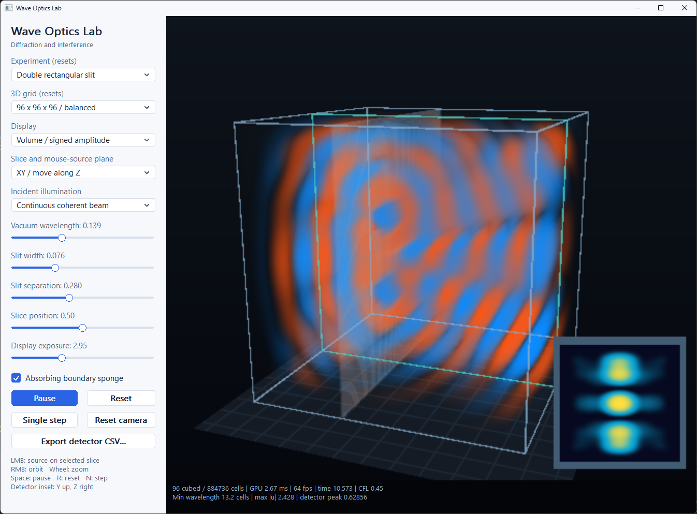

# Wave Optics Lab — 3D GPU Edition



**Interface update:** This project uses the shared modern WinAPI interface: flat themed controls, scrollable settings and keyboard navigation. See [Modern UI](../../MODERN_UI.md). Simulation shortcuts apply when the 3D canvas has focus; focused controls use their native keys.

A native Windows laboratory for **three-dimensional scalar wave propagation**. OpenGL compute shaders evolve the field throughout a cubic volume, including propagation along X, Y and Z, diffraction at finite apertures, coherent interference, and refraction through a variable-index medium. A volume renderer, movable slices and a two-dimensional detector read the GPU data directly.

The project uses **C++23, WinAPI, WGL, OpenGL 4.3 Core and Visual Studio 2026**. It has no third-party libraries, physics engine, package manager, external assets or shader files to deploy. The executable embeds all GLSL sources.

## Build and run

1. Install Visual Studio 2026 with **Desktop development with C++**, **MSVC v145**, and a Windows SDK.
2. Open `WaveOpticsLab3D.sln` in the package root. The full collection also supports `PhysicsLab.sln`.
3. Build **Release | x64** and run `04_WaveOpticsLab`.
4. Alternatively, run `powershell -ExecutionPolicy Bypass -File .\BuildWaveOptics3D.ps1`.

The executable is `bin/x64/Release/04_WaveOpticsLab.exe`. It runs from any working directory. Debug and Release use the static Microsoft runtime, with only Windows system DLLs and the installed graphics driver needed at runtime. MSVC 14.51.36231 uses `/std:c++23preview` for C++23. Both configurations use x64 and toolset v145.

An interactive desktop and **OpenGL 4.3 Core** graphics driver are required. OpenGL 4.0–4.2 alone does not provide the core compute features used here. Context or shader failures produce an error message; the program does not silently fall back to CPU physics. OpenGL entry points are loaded directly through WGL, using the Windows SDK headers and import libraries.

## Experiments

| Experiment | Geometry and behavior |
|---|---|
| Double rectangular slit | A reflecting zero-field screen at X ≈ 0.36 has two finite rectangular apertures separated along Y. Each slit has Z extent 0.44. Transmitted waves interfere in the downstream volume and on the Y-Z detector. |
| Circular aperture | The same screen contains a circular opening in its Y-Z plane. Diffraction spreads in both transverse directions. |
| Refractive ball lens | A spherical region centered at (0.49, 0.5, 0.5) has adjustable radius and refractive index from 1 to 2. The index changes the update equation and phase velocity; the green outline marks the lens region. |

The incident soft source is a smoothly apodized plane at X ≈ 0.16. It radiates in both X directions; the left-going component is damped by the boundary sponge. Illumination can be continuous, a Gaussian-windowed pulse, or off. Turning the source off preserves existing waves so that propagation and decay can be observed. Selecting continuous or pulse illumination restarts the experiment.

### Resolution

| Grid | Scalar field samples | Approximate GPU simulation-buffer allocation |
|---|---:|---:|
| 64³ | 262,144 | 6.1 MiB |
| 96³ | 884,736 | 20.6 MiB |
| 128³ | 2,097,152 | 48.8 MiB |

The memory figures cover simulation fields, medium, detector and reductions, not render targets, programs or driver overhead. There is an independent sample at every volume grid point; the 3D view is not an extrusion of a 2D simulation.

## Controls

- **Left mouse hold/drag:** add a localized coherent source on the selected slice plane. The source follows a ray–plane intersection in 3D. Release stops it. This tool is inactive in the detector-only view.
- **Right drag:** orbit the volume. **Mouse wheel:** zoom. **Reset camera:** restore the initial view.
- **Space / Pause:** pause or resume. **R / Reset:** clear the field and restart. **N / Single step:** pause and advance exactly one FDTD step. **Escape:** close.
- **Display:** signed-amplitude volume, mean-intensity volume, signed-amplitude slice, mean-intensity slice, or detector-only view.
- **Slice plane:** XY, XZ or YZ. The slice-position slider moves it from 0.12 to 0.88 along the remaining axis. The outlined plane also defines the mouse-source placement plane in volume views.
- **Export detector CSV:** open a native Windows save dialog and save raw detector values with metadata. Export does not normalize the data.

Positive amplitude is orange, negative amplitude is blue. The intensity palette runs from dark blue through cyan to yellow. The detector has Y pointing up and Z to the right. Its color scale is logarithmic and normalized by the current detector peak, independently of the exposure slider. It remains dark when the signal is zero. Volume/slice exposure changes presentation only.

The geometry slider controls slit width, circular-aperture radius or lens radius, depending on the experiment. The next slider controls slit separation or refractive index; it has no effect in circular-aperture mode. The boundary checkbox selects a damping sponge or reflecting outer boundary. Geometry, resolution, wavelength, index and boundary changes reset the field. Display, exposure and slice changes preserve it.

### Units and sampling

The domain is `[0,1]³` and vacuum wave speed is **c₀ = 1**. Coordinates and vacuum wavelength are in domain-length units; time is in domain-crossing-time units, not seconds or nanoseconds. The index reduces local wavelength and speed by the same factor.

The wavelength slider automatically keeps at least **eight grid intervals per local wavelength**, including inside the lens. Its minimum is `8 * maximumIndex / (N-1)`; its maximum is `max(0.24, minimum + 0.08)`. Changing grid resolution or index remaps this range and can change the selected vacuum wavelength; check the updated label when comparing experiments. Eight intervals is a practical lower limit, not a guarantee of negligible dispersion. Use more intervals for precision studies.

At a nominal 60 Hz application update, the solver takes `ceil(N/12)` physical steps. Slow hardware slows simulated time rather than increasing the numerical timestep. The status reports the 3D cell count, GPU compute time for the previous completed batch, display fps, simulated time, Courant number, minimum local wavelength sampling, maximum amplitude and raw detector peak. GPU timing excludes rendering and CPU readback.

## Numerical model

Let `m(x) = refractiveIndex(x)²`. With normalized vacuum speed, the scalar equation is

```text
m(x) * (u_tt + 2 sigma(x) u_t) = Laplacian(u) + forcing
```

The grid uses a six-neighbor, seven-point 3D Laplacian and a centered second-order time stencil. With `h = 1/(N-1)`, `dt = 0.45 h`, and `d = sigma dt`, each free cell advances as

```text
lap = u[x-1] + u[x+1] + u[y-1] + u[y+1] + u[z-1] + u[z+1] - 6u
uNext = (2u - (1-d)uPrevious + 0.45² * lap / m + drive) / (1+d)
```

The Courant number **0.45** is below the homogeneous cubic-grid limit `1/sqrt(3)`. Because the material index is never below 1, vacuum is the fastest medium and controls that bound. The scheme has finite numerical dispersion and directional error. The sphere and aperture boundary are sampled on the Cartesian grid.

Opaque screen cells and the outermost grid shell impose `u = 0`; the screen therefore reflects as well as blocks. The optional sponge occupies the outer 0.13 domain units on each face, with `sigma = 80 * max(0, 1-distance/0.13)³`. It damps temporal variation and reduces returning waves. It is **not a perfectly matched layer** and does not eliminate every reflection.

The continuous source ramps on smoothly over a few periods. The pulse has envelope `exp(-((t-3 lambda)/lambda)²)` and the same sinusoidal carrier. The mouse source has a Gaussian radius of 1.5 grid intervals and shares the carrier phase. These are illustrative source amplitudes, not a calibrated optical-power injection model.

### Intensity and detector

Every cell accumulates an exponential moving average of squared scalar amplitude:

```text
alpha = 1 - exp(-dt / (4 lambda))
I = (1-alpha) I + alpha uNext²
```

The Y-Z detector samples this average at the grid plane nearest X = 0.82. It is a non-invasive probe: it does not absorb the wave. The intensity is a **scalar signal proxy**, not a Poynting vector, radiance, irradiance or measurement in watts. The automatically normalized detector view cannot be used to compare absolute power between experiments; use its reported peak or the raw CSV values instead. A pulse leaves a decaying averaging history after the instantaneous wave has gone.

CSV files contain two comment/metadata lines, followed by `y,z,mean_squared_amplitude` and `N²` data rows. Skip the first two lines when importing with a strict CSV reader. Coordinates cover the full detector grid, including the outer shell and sponge.

### GPU execution and memory ordering

Seven SSBO bindings contain the current, previous and next scalar fields; mean intensity; index-squared/damping pairs; partial/final diagnostics; and the detector. Each compute invocation writes one independent grid cell and reads neighbors only from the immutable current time level. Three field buffers rotate after each dispatch. There are no floating-point atomics or inter-workgroup spin barriers.

`GL_SHADER_STORAGE_BARRIER_BIT` separates dependent dispatches and rendering. `GL_BUFFER_UPDATE_BARRIER_BIT` precedes CPU readbacks. The CPU dispatches work, handles controls and camera geometry, and supplies uniforms. It does not advance the interactive wave equation. Full field readback and the CPU stencil exist only in validation; routine status downloads 48 bytes and detector export downloads one 2D plane.

The renderer ray-marches the actual volume with trilinear SSBO sampling and front-to-back compositing. Volume modes render at half viewport width and height and upscale with bilinear filtering to keep interaction responsive. Slice and detector modes render at full viewport resolution. Field resolution is independent of this display optimization. Box/slice outlines, the floor and optical-object outlines are explanatory graphics, not electromagnetic fields.

GPU diagnostics include finite-state checks, zero-field enforcement in the opaque screen, intensity maxima, downstream signal, and the discrete half-step energy

```text
E = 1/2 sum[ m ((u-uPrevious)/dt)² + grad_h(u) dot grad_h(uPrevious) ] h³
```

That energy is useful for source-free, undamped verification. It is not expected to remain constant when a source drives the field or the sponge dissipates it. An invalid state detected by the status check pauses the application.

## Scope

This is a **3D scalar wave model**, not a vector Maxwell solver. It does not simulate polarization, separate electric/magnetic vector fields, vector electromagnetic interface conditions, material dispersion, nonlinear optics, physical absorption spectra or calibrated Fresnel coefficients. The ball lens uses a scalar variable-index approximation. It is not a replacement for an electromagnetic design or optical metrology tool.

Finite apertures and a finite propagation distance can produce near-field patterns. No Fraunhofer or ideal Airy-pattern formula is used to fabricate the detector image. The finite beam, reflective screen, sampled geometry, sponge and grid dispersion all influence the computed result.

## Files

- `WaveOptics3D.cpp`: application, native controls, GPU dispatch, renderer setup, detector export and validation.
- `OpticsShaders.hpp`: embedded initialization, 3D wave, reduction and rendering shaders.
- `GpuApi.hpp`: WGL bootstrap, OpenGL function loading, resources and shader diagnostics.
- `Math3D.hpp`: small vector and orbit-camera utilities.

The full collection retains the old 2D `Simulation.cpp` for `PhysicsCore` and the legacy CPU regression tests. It is **not linked into the new executable** and is omitted from the standalone package. Project 04 no longer references `PhysicsCore`.

## Validation

Run `powershell -ExecutionPolicy Bypass -File .\TestWaveOptics3D.ps1` after building Release. It creates a real OpenGL context, runs `--gpu-test`, saves reports, framebuffer images and a sample detector CSV, and requires a passing process exit code and a fresh `ALL PASSED` report. Its explicit standard-stream pipes support automation hosts without inherited console handles. Tests briefly display a non-activating window and do not move the user's mouse.

The suite checks an independent CPU stencil/EMA oracle, exact zero equilibrium, 3D discrete eigenmodes, energy conservation, dispersion convergence, pulse absorption, all optical experiments, detector symmetry, propagation outside the central slice, index-dependent focusing, multiple resolutions, minimum-wavelength stability, mouse-plane mapping, source release, five render modes, CSV export and native control handlers. `--smoke` advances 180 normal batches and saves `Lab04_smoke.txt` and `Lab04.bmp` to the working directory.

See `ValidationWaveOptics3D/VALIDATION.md` and the logs for measured results and verification limits. Passing this suite does not establish accuracy for arbitrary optical hardware or all graphics drivers.

## References

These are background reading, not source-code or runtime dependencies:

- John B. Schneider, [Understanding the FDTD Method](https://eecs.wsu.edu/~schneidj/ufdtd/index.html), especially [three-dimensional grids and stability](https://eecs.wsu.edu/~schneidj/ufdtd/chap9.pdf). That text develops electromagnetic FDTD; this application's scalar stencil is described explicitly above.
- Khronos, [Compute Shader](https://wikis.khronos.org/opengl/Compute_Shader) and [glMemoryBarrier](https://wikis.khronos.org/opengl/GLAPI/glMemoryBarrier).
